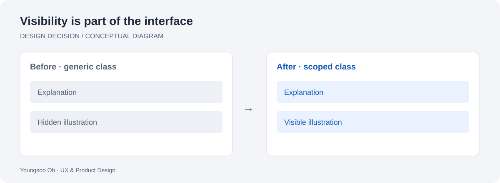

# Product graphics that survive CSS naming collisions

[All studies](../README.md) · [Portfolio](https://brilliant-puffpuff-c0d032.netlify.app/)

*Original explanatory diagram, not a product screenshot. English · Deutsch · 한국어 below.*

## English

**Problem.** Two illustration class names, `ad-detail` and `ad-mobile`, also matched generic content-hiding rules. Under those rules, a meaningful part of the product explanation disappeared.

**Decision.** Use a product-specific namespace consistently across static markup, styles and dynamically generated illustrations. Preserve the illustration and the visitor's browsing preferences.

**Before → after.** With the same two hiding rules applied, the old components disappear; the renamed components remain visible. This isolates a naming collision rather than relying on an unexplained visual refresh.

**Evidence and limits.** The private archive preserves the v13/v14 source and a controlled browser reproduction. The reproduction applies two CSS rules; it does not identify the original visitor's extension or establish compatibility with every filter list. Historical checks also cover all nine OS illustrations. Those historical counts are not presented as a current full-browser certification.

**Next validation.** Check representative current filtering configurations and retain the reproduction when changing illustration classes.

## Deutsch — CSS-Namenskonflikte bei Produktgrafiken beheben

**Problem.** Die Klassen `ad-detail` und `ad-mobile` stimmten mit allgemeinen Ausblendregeln überein. Dadurch verschwanden wichtige Teile der Produkterklärung.

**Entscheidung.** Ein produktspezifischer Namensraum wird einheitlich in statischem HTML, CSS und dynamisch erzeugten Illustrationen verwendet. Die Darstellung und die Browsereinstellungen der Besucher bleiben erhalten.

**Vorher → nachher.** Unter denselben zwei Regeln verschwinden die alten Komponenten; die umbenannten bleiben sichtbar. So lässt sich der Namenskonflikt gezielt nachweisen.

**Nachweis und Grenzen.** Das private Archiv enthält die Quellen von v13/v14 und eine kontrollierte Browser-Reproduktion mit zwei CSS-Regeln. Diese identifiziert weder die ursprünglich verwendete Erweiterung noch garantiert sie Kompatibilität mit allen Filterlisten. Historische Prüfungen umfassen auch die neun Betriebssystem-Illustrationen; sie sind keine aktuelle Zertifizierung für alle Browser.

**Nächster Schritt.** Repräsentative aktuelle Filterkonfigurationen prüfen und die Reproduktion bei Änderungen an den Klassennamen erhalten.

## 한국어 — CSS 이름 충돌로 사라진 제품 그래픽 복구

**문제.** 제품 일러스트의 `ad-detail`, `ad-mobile` 클래스가 일반적인 콘텐츠 숨김 규칙과 겹쳐 제품 설명의 일부가 사라졌다.

**판단.** 정적 HTML, CSS, 동적으로 생성되는 일러스트에 제품 전용 이름을 일관되게 적용했다. 기존 일러스트와 방문자의 브라우저 설정을 유지했다.

**수정 전 → 후.** 동일한 두 숨김 규칙 아래에서 이전 컴포넌트는 사라지고 이름을 바꾼 컴포넌트는 보인다. 화면을 새로 꾸미는 데 그치지 않고 이름 충돌을 분리해 확인했다.

**근거와 한계.** 비공개 저장소에 v13/v14 원본과 통제된 브라우저 재현 자료가 있다. 두 CSS 규칙을 적용한 재현이며 사용자가 실제로 쓴 확장 프로그램을 특정하거나 모든 필터 목록의 호환성을 보장하지 않는다. 당시에는 9개 OS 일러스트도 확인했다. 과거 검사 수치를 현재 모든 브라우저의 인증처럼 제시하지 않는다.

**다음 검증.** 대표적인 최신 필터 환경을 확인하고, 일러스트 클래스가 바뀔 때 재현 절차를 유지한다.
