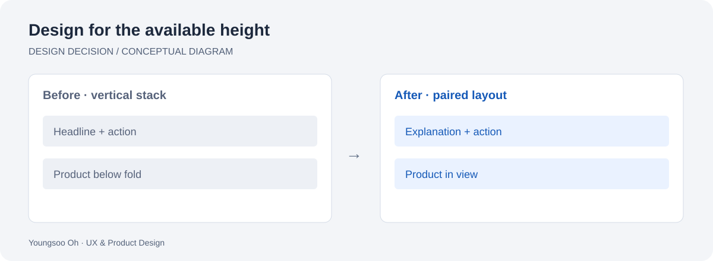

# A hero that fits the laptop viewport

[All studies](../README.md) · [Portfolio](https://brilliant-puffpuff-c0d032.netlify.app/)

*Original explanatory diagram, not a product screenshot. English · Deutsch · 한국어 below.*

## English

**Problem.** A centered, vertically stacked hero gave the headline generous space but pushed the product illustration below the first viewport on shorter laptop windows.

**Decision.** Arrange copy and product side by side on suitable desktop widths, account for viewport height, and return to a vertical layout on smaller screens and with enlarged text. Keep the primary action beside its explanation.

**Before → after.** The v15 composition prioritizes the headline above the product. The v16 composition brings explanation, download and the full product figure into the first laptop viewport. The private evidence compares both versions at the same 1280 × 620 viewport.

**Evidence and limits.** Archived design notes and a fresh rendering support the layout comparison. These show placement, not improved conversion, faster task completion or usability-study results. A single viewport is an illustration of the fix, not a complete responsive audit.

**Next validation.** Check enlarged text, keyboard navigation and additional viewport heights in Safari and Firefox as well as Chromium.

## Deutsch — Ein Hero-Bereich für die sichtbare Laptopfläche

**Problem.** Der zentrierte, vertikal aufgebaute Hero-Bereich gab der Überschrift viel Raum. Auf niedrigen Laptopfenstern rutschte die Produktgrafik jedoch unter den zunächst sichtbaren Bereich.

**Entscheidung.** Text und Produkt bei geeigneter Desktopbreite nebeneinander anordnen und die Fensterhöhe berücksichtigen. Auf kleineren Bildschirmen und bei vergrößerter Schrift bleibt eine vertikale Anordnung erhalten. Die Hauptaktion steht bei ihrer Erklärung.

**Vorher → nachher.** v15 setzt die Überschrift über das Produkt. v16 bringt Erklärung, Download und die vollständige Produktabbildung in den ersten Laptop-Bildausschnitt. Die privaten Nachweise vergleichen beide Versionen bei 1280 × 620 Pixeln.

**Nachweis und Grenzen.** Archivierte Designnotizen und neu gerenderte Ansichten belegen die Anordnung. Sie belegen keine höhere Conversion, kürzere Bearbeitungszeit oder Ergebnisse einer Nutzungsstudie. Eine Fenstergröße ersetzt keine vollständige Responsive-Prüfung.

**Nächster Schritt.** Vergrößerte Schrift, Tastaturbedienung und weitere Fensterhöhen auch in Safari und Firefox prüfen.

## 한국어 — 노트북 첫 화면에 맞는 히어로 구성

**문제.** 중앙 정렬의 세로형 히어로는 제목에 넉넉한 공간을 주었지만, 높이가 낮은 노트북 창에서는 제품 그림이 첫 화면 아래로 밀렸다.

**판단.** 적절한 데스크톱 너비에서는 설명과 제품을 나란히 놓고 창 높이도 고려했다. 좁은 화면과 큰 글씨에서는 세로 배치를 유지하며 주요 행동을 설명 가까이에 두었다.

**수정 전 → 후.** v15는 제품 위의 제목을 강조했다. v16은 설명, 다운로드와 제품 그림 전체를 노트북 첫 화면 안으로 모았다. 비공개 근거 자료는 같은 1280 × 620 화면에서 두 버전을 비교한다.

**근거와 한계.** 보관된 디자인 기록과 새로 렌더링한 화면으로 배치 차이를 확인했다. 전환율 상승, 작업 시간 단축이나 사용자 연구 결과를 뜻하지 않는다. 단일 화면 크기의 비교는 전체 반응형 검수를 대체하지 않는다.

**다음 검증.** Chromium 외에도 Safari와 Firefox에서 큰 글씨, 키보드 탐색과 다양한 화면 높이를 확인한다.
