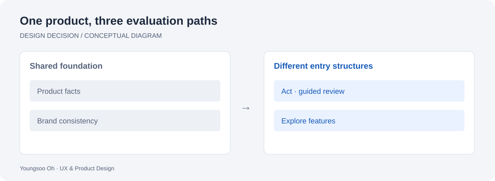

# Localization as an interaction decision

[All studies](../README.md) · [Portfolio](https://brilliant-puffpuff-c0d032.netlify.app/)

*Original explanatory diagram, not a product screenshot. English · Deutsch · 한국어 below.*

## English

**Problem.** Translating the same page leaves its reading order and interaction model unchanged. The project explored whether different paths could make the same product easier to evaluate in Korean, Japanese and Simplified Chinese.

**Decision.** Keep a shared product and brand foundation while exploring three structures: action-oriented entry points in the Korean prototype, a guided evaluation sequence in the Japanese prototype, and direct feature exploration in the Chinese prototype.

**Before → after.** The work expands from a Korean prototype into three localized experiences. This is a comparison of design approaches, not a controlled experiment between equivalent populations.

**Evidence and limits.** The private v22 archive contains all three interfaces and research documents tied to that exact snapshot. Current Chromium checks cover language switching, navigation, OS selection and main destinations at desktop and mobile sizes. Technical checks establish behavior; they do not validate cultural assumptions. These are project hypotheses, not universal claims about national preferences. No conversion lift or native-speaker usability outcome is claimed.

**Next validation.** Test the same product-evaluation tasks with native speakers, document recruitment and observations, and revise the hypotheses from that evidence.

## Deutsch — Lokalisierung als Interaktionsentscheidung

**Problem.** Eine reine Übersetzung verändert weder Lesereihenfolge noch Interaktionsmodell. Das Projekt untersucht unterschiedliche Wege, dasselbe Produkt auf Koreanisch, Japanisch und vereinfachtem Chinesisch zu beurteilen.

**Entscheidung.** Eine gemeinsame Produkt- und Markengrundlage bleibt erhalten. Der koreanische Prototyp betont direkte Einstiege, der japanische eine geführte Prüfung und der chinesische die unmittelbare Erkundung von Funktionen.

**Vorher → nachher.** Aus einem koreanischen Prototyp entstehen drei lokalisierte Erlebnisse. Dies vergleicht Gestaltungsansätze und ist kein kontrolliertes Experiment mit vergleichbaren Nutzergruppen.

**Nachweis und Grenzen.** Das private v22-Archiv enthält alle drei Oberflächen und Dokumente, die genau diesem Stand zugeordnet sind. Aktuelle Chromium-Prüfungen umfassen Sprachwechsel, Navigation, Betriebssystemwahl und zentrale Ziele auf Desktop und Mobilgeräten. Sie prüfen Funktionen, keine kulturellen Annahmen. Die Ansätze sind Projekthypothesen, keine allgemeinen Aussagen über nationale Vorlieben. Eine Conversion-Steigerung oder validierte muttersprachliche Nutzbarkeit wird nicht behauptet.

**Nächster Schritt.** Dieselben Aufgaben zur Produktbewertung mit Muttersprachlern testen, Rekrutierung und Beobachtungen dokumentieren und die Hypothesen entsprechend überarbeiten.

## 한국어 — 인터랙션 설계로 확장한 현지화

**문제.** 같은 페이지의 문구만 번역하면 읽는 순서와 인터랙션은 그대로 남는다. 한국어·일본어·중국어 간체로 같은 제품을 살펴보는 경로를 다르게 설계할 수 있는지 탐색했다.

**판단.** 제품과 브랜드의 공통 기반을 유지하면서 한국어는 행동 중심 진입, 일본어는 단계적인 검토, 중국어는 기능을 바로 탐색하는 구조를 시도했다.

**이전 → 이후.** 한국어 프로토타입에서 세 가지 현지화 경험으로 확장했다. 동등한 사용자 집단 사이의 통제 실험이 아니라 설계 접근의 비교다.

**근거와 한계.** 비공개 v22 보관본에는 세 인터페이스와 해당 버전에 연결된 연구 문서가 있다. 현재 Chromium 자동 검사는 데스크톱·모바일의 언어 전환, 탐색, OS 선택과 주요 목적지를 확인한다. 기능 검사가 문화적 가설까지 입증하지는 않는다. 각 접근은 프로젝트의 가설이며 국가별 보편적 선호로 단정하지 않는다. 전환율 상승이나 원어민 사용성 검증 결과도 주장하지 않는다.

**다음 검증.** 원어민에게 동일한 제품 검토 과제를 주고 모집 기준과 관찰 결과를 기록한 뒤 가설을 수정한다.
